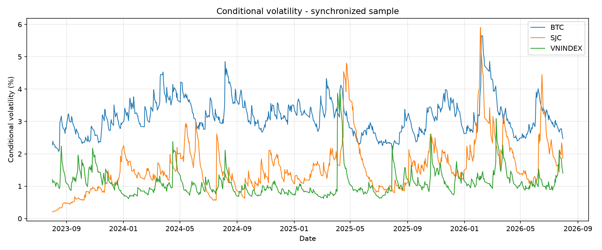
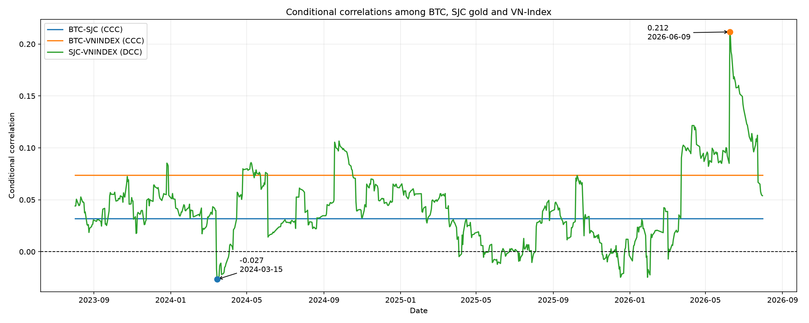
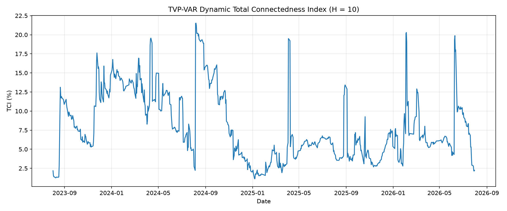
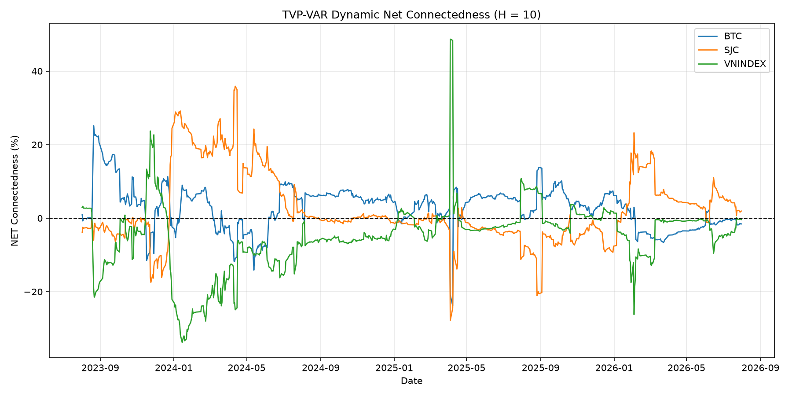

# Econometrics: Biến động, tương quan và lan tỏa rủi ro giữa Bitcoin, vàng SJC và VN-Index

Dự án phân tích rủi ro của ba tài sản tại Việt Nam: **Bitcoin (quy đổi VND), vàng miếng SJC và VN-Index**, giai đoạn 08/2023–08/2026. Phân tích gồm ba bước nối tiếp nhau. Đầu ra của bước trước là đầu vào của bước sau:

```text
Giá tài sản → Lợi suất
    ↓
Bước 1. ARMA–EGARCH ──► biến động có điều kiện σₜ  +  phần dư chuẩn hóa zₜ
    ↓                          │                              │
    │                          │                              ▼
    │                          │          Bước 2. CCC/DCC–GARCH → tương quan có điều kiện
    │                          ▼
    └────────────► Bước 3. TVP-VAR(1) → TVP-GFEVD → TCIₜ, FROMₜ, TOₜ, NETₜ, net theo cặp
```

## 1. Cấu trúc dự án

```text
btc-sjc-vnindex-risk-analysis/
├── 3y-bitcoin-vnd-returns.csv        # Dữ liệu đầu vào: giá và lợi suất Bitcoin (VND)
├── 3y-gold-returns.csv               # Dữ liệu đầu vào: giá và lợi suất vàng SJC
├── 3y-vnindex-returns.csv            # Dữ liệu đầu vào: giá và lợi suất VN-Index
├── DATA_PROVENANCE.md                # Nguồn gốc và quy trình làm sạch dữ liệu
├── requirements.txt
│
├── run_all.py                        # Chạy cả 3 bước theo thứ tự
├── step1_arma_egarch.py              # Bước 1: ARMA–EGARCH
├── step2_dcc_garch.py                # Bước 2: CCC/DCC–GARCH
├── step3_connectedness.py            # Bước 3: TVP-VAR connectedness
│
├── src/
│   ├── risk_analysis/                # Code dùng chung cho Bước 1–2
│   │   ├── config.py                 #   đường dẫn, đặc tả mô hình đã chọn, tham số
│   │   ├── data.py                   #   đọc dữ liệu, đồng bộ lịch, thống kê mô tả
│   │   ├── stationarity.py           #   ADF, PP, KPSS, Zivot–Andrews
│   │   ├── arma_egarch.py            #   tìm ARMA/EGARCH, ước lượng, kiểm định phần dư
│   │   ├── dcc.py                    #   DCC(1,1) multi-start, CCC, Engle–Sheppard
│   │   ├── plotting.py
│   │   └── reporting.py
│   └── tvp_connectedness/            # Code cho Bước 3
│       ├── model.py                  #   TVP-VAR(1) bằng Kalman filter với forgetting factors
│       ├── gfevd.py                  #   GFEVD tổng quát theo từng thời điểm
│       ├── connectedness.py          #   TCI, FROM, TO, NET, net theo cặp
│       ├── diagnostics.py            #   bán kính phổ, giai đoạn bất ổn cục bộ
│       ├── lag_selection.py, pipeline.py, io.py, plots.py
│
├── Notebook-3assets-Volatility.ipynb          # Notebook Bước 1–2: output và nhận xét chi tiết
├── Notebook-tvp-var-connectedness.ipynb       # Notebook Bước 3: output và nhận xét chi tiết
│
├── outputs/                          # Bảng kết quả (CSV)
│   ├── model2_conditional_volatility.csv   # σₜ đồng bộ, đầu vào của Bước 3
│   ├── step1_arma_egarch/
│   ├── step2_dcc_garch/
│   └── step3_connectedness/
└── figures/                          # Hình, mỗi bước một thư mục riêng
    ├── step1_arma_egarch/
    ├── step2_dcc_garch/
    └── step3_connectedness/
```

## 2. Mục tiêu: ba câu hỏi, ba mô hình

| # | Câu hỏi nghiên cứu | Mô hình |
|---|---|---|
| 1 | Biến động của từng tài sản lớn đến đâu, dai dẳng ra sao, và tin xấu có làm biến động tăng mạnh hơn tin tốt không? | **ARMA–EGARCH** với phân phối Student-t |
| 2 | Tương quan giữa các cặp tài sản cao hay thấp, và có thay đổi theo thời gian không? Kết hợp ba tài sản có đa dạng hóa được không? | **CCC/DCC(1,1)–GARCH** |
| 3 | Rủi ro lan truyền giữa ba thị trường mạnh đến đâu, tài sản nào truyền và tài sản nào nhận, và vai trò đó thay đổi thế nào theo thời gian? | **TVP-VAR(1)** + GFEVD theo thời gian (chỉ số connectedness Diebold–Yılmaz) |

Bản tiểu luận ban đầu dùng **VAR(9)–Diebold–Yılmaz tĩnh** cho câu hỏi 3. Mô hình tĩnh chỉ cho một bức tranh trung bình cho cả mẫu. Dự án đã chuyển sang **TVP-VAR** để theo dõi cường độ và chiều lan truyền thay đổi theo từng ngày.

## 3. Dữ liệu đầu vào

| File | Tài sản | Nguồn | Cột chính | Số lợi suất |
|---|---|---|---|---:|
| `3y-bitcoin-vnd-returns.csv` | Bitcoin quy đổi VND | Yahoo Finance (`BTC-USD`, `VND=X`) | `btc_vnd_price`, `btc_return` | 1.096 |
| `3y-gold-returns.csv` | Vàng miếng SJC, TP.HCM | Giá công khai của PNJ | `gold_price`, `gold_return` | 909 |
| `3y-vnindex-returns.csv` | VN-Index | KBS qua thư viện `vnstock` | `vnindex_price`, `vnindex_return` | 747 |

- **Giai đoạn:** 01/08/2023–01/08/2026 (VN-Index kết thúc vào phiên 31/07/2026).
- **Lợi suất:** log-return dạng phần trăm, $r_t = 100 \ln(P_t / P_{t-1})$, tính trên lịch giao dịch riêng của từng tài sản.
- **Giá Bitcoin theo VND** = giá BTC/USD × tỷ giá USD/VND. Ngày không có tỷ giá dùng tỷ giá hợp lệ gần nhất trước đó.
- **Giá vàng** = trung bình giá mua và giá bán.
- **Mẫu đồng bộ** cho Bước 2–3: chỉ giữ các ngày cả ba tài sản đều có giá, rồi tính lại lợi suất trên các ngày chung. Kết quả là **747 quan sát**, từ 02/08/2023 đến 31/07/2026.

Ba file dữ liệu được tạo bởi pipeline [goldvn-data-pipeline](https://github.com/htrang22/goldvn-data-pipeline). Repository pipeline không lưu hay phân phối dữ liệu giá vàng thô. Chi tiết nguồn và quy tắc làm sạch xem [DATA_PROVENANCE.md](./DATA_PROVENANCE.md).

## 4. Phương pháp

### Bước 1 – ARMA–EGARCH (`step1_arma_egarch.py`)

1. **Kiểm định tính dừng** của lợi suất: ADF, Phillips–Perron, KPSS, và Zivot–Andrews (cho phép một điểm gãy cấu trúc).
2. **Chọn phương trình trung bình ARMA(p,q):** quét lưới mô hình, xếp hạng theo AIC/BIC, giữ những mô hình có phần dư qua kiểm định Ljung–Box.
3. **Kiểm định ARCH-LM** trên phần dư ARMA để xác nhận có phương sai thay đổi.
4. **Ước lượng EGARCH(p,o,q)-t** trên phần dư ARMA (ước lượng hai bước). So sánh 4 ứng viên, rồi kiểm định Ljung–Box trên $z_t$ và $z_t^2$ và ARCH-LM sau ước lượng.

Bước này chạy trên hai mẫu:

| Mẫu | Mục đích | Đặc tả cuối cùng |
|---|---|---|
| **A. Lịch riêng** (Model 1) | Đặc điểm biến động của từng tài sản | BTC: ARMA(0,0)–EGARCH(1,1,2)-t · SJC: ARMA(0,1)–EGARCH(1,1,1)-t · VN-Index: ARMA(0,5)–EGARCH(1,1,1)-t |
| **B. Đồng bộ** (747 quan sát) | Tạo $z_t$ cho Bước 2 và $\sigma_t$ cho Bước 3 | BTC: ARMA(1,0) · SJC: ARMA(0,0) · VN-Index: ARMA(0,5), cả ba với EGARCH(1,1,1)-t |

### Bước 2 – CCC/DCC–GARCH (`step2_dcc_garch.py`)

- **Đầu vào:** phần dư chuẩn hóa $z_t = \varepsilon_t / \sigma_t$ của mẫu đồng bộ.
- **Mô hình:** DCC(1,1) cho từng cặp tài sản:

  $$
  Q_t = (1-a-b)\bar Q + a\, z_{t-1} z_{t-1}' + b\, Q_{t-1}, \qquad
  R_t = \mathrm{diag}(Q_t)^{-1/2}\, Q_t\, \mathrm{diag}(Q_t)^{-1/2}
  $$

- **Ước lượng:** multi-start SLSQP với 18 điểm khởi tạo, ràng buộc $a, b \ge 0$ và $a + b < 1$. Cặp nào có $a \approx 0$ thì kết luận là **CCC** (tương quan hằng).
- **Kiểm định Engle–Sheppard** về tính hằng của tương quan tại độ trễ 1, 2, 5, 10.
- **Kiểm tra ma trận tương quan:** xác định dương, các hệ số nằm trong $[-1, 1]$.
- **Mô tả đường DCC:** tìm các giai đoạn tương quan tăng mạnh, giảm mạnh hoặc đổi dấu.

### Bước 3 – TVP-VAR connectedness (`step3_connectedness.py`)

1. **Đầu vào:** biến động có điều kiện $\sigma_t$ của mẫu đồng bộ. Kiểm định tính dừng (ADF, PP, KPSS, Zivot–Andrews cho SJC).
2. **Chọn độ trễ:** BIC và HQIC cùng chọn $p = 1$, nên dùng **TVP-VAR(1)**.
3. **Ước lượng TVP-VAR(1)** bằng Kalman filter với hai forgetting factor:
   - $\lambda_\beta = 0{,}999$ cho hệ số;
   - $\kappa_\Sigma = 0{,}96$ cho ma trận hiệp phương sai cú sốc;
   - giá trị khởi tạo lấy từ VAR(1) tĩnh.
4. **GFEVD tổng quát** (Pesaran–Shin) tại từng thời điểm, horizon $H = 10$, chuẩn hóa theo hàng. Từ đó tính:
   - $TCI_t$: chỉ số kết nối tổng thể;
   - $FROM_t$ (nhận từ thị trường khác), $TO_t$ (truyền sang thị trường khác), $NET_t = TO_t - FROM_t$;
   - net theo cặp $i \to j = \theta_{ji,t} - \theta_{ij,t}$.
5. **Chẩn đoán:** bán kính phổ của ma trận hệ số tại từng thời điểm, để phát hiện các giai đoạn bất ổn cục bộ.
6. **Độ vững:** 6 đặc tả với $\lambda_\beta \in \{0{,}999;\ 0{,}997\}$, $\kappa_\Sigma \in \{0{,}94;\ 0{,}96;\ 0{,}98\}$, $H \in \{5;\ 10;\ 20\}$.

## 5. Cách chạy

### Chạy script Python

```bash
pip install -r requirements.txt
python3 run_all.py            # chạy cả 3 bước, khoảng 1 phút
python3 run_all.py --quick    # bỏ qua bước tìm mô hình ứng viên ở Bước 1, khoảng 10 giây
```

Có thể chạy riêng từng bước, nhưng phải theo đúng thứ tự vì bước sau đọc file do bước trước tạo ra:

```bash
python3 step1_arma_egarch.py
python3 step2_dcc_garch.py
python3 step3_connectedness.py
```

Chạy các lệnh từ thư mục gốc của repository. Code đã được kiểm tra với Python 3.14.

| Bước | Đọc | Ghi bảng | Ghi hình |
|---|---|---|---|
| 1 | 3 file CSV lợi suất | `outputs/step1_arma_egarch/`, `outputs/model2_conditional_volatility.csv` | `figures/step1_arma_egarch/` |
| 2 | `outputs/step1_arma_egarch/synchronized_std_residuals.csv` | `outputs/step2_dcc_garch/` | `figures/step2_dcc_garch/` |
| 3 | `outputs/model2_conditional_volatility.csv` | `outputs/step3_connectedness/` | `figures/step3_connectedness/` |

Bậc mô hình cuối cùng được cố định trong [`src/risk_analysis/config.py`](./src/risk_analysis/config.py). Lý do: lựa chọn kết hợp AIC, BIC, kiểm định phần dư và nguyên tắc mô hình gọn, nên không phải lúc nào cũng trùng với ứng viên đứng đầu một tiêu chí. Bảng ứng viên vẫn được lưu ra file `*_candidates.csv` để đối chiếu.

### Đọc notebook để xem output và nhận xét chi tiết

Script chỉ in và lưu kết quả. Phần diễn giải chi tiết từng kiểm định và từng bảng nằm trong hai notebook:

| Notebook | Phần | Nội dung |
|---|---|---|
| [`Notebook-3assets-Volatility.ipynb`](./Notebook-3assets-Volatility.ipynb) | MODEL 1 | Bước 1A: tính dừng, chọn ARMA, ARCH-LM, chọn EGARCH, phương trình ước lượng và chẩn đoán |
| | MODEL 2 | Bước 1B (mẫu đồng bộ) và Bước 2: kiểm tra phần dư SJC, DCC từng cặp, Engle–Sheppard, giai đoạn tương quan |
| | MODEL 3 | VAR(9)–Diebold–Yılmaz tĩnh, giữ lại để tham chiếu và so sánh với TVP-VAR |
| [`Notebook-tvp-var-connectedness.ipynb`](./Notebook-tvp-var-connectedness.ipynb) | Mục 1–6 | Bước 3: tính dừng của σₜ, chọn độ trễ, TVP-VAR(1), độ ổn định, TVP-GFEVD, connectedness theo thời gian |
| | Mục 7 | Độ vững với 6 đặc tả, các giai đoạn bất ổn cục bộ, so sánh DY-VAR(9) tĩnh với TVP-VAR(1) |

Mở notebook bằng Jupyter hoặc Google Colab, đặt thư mục gốc repository làm working directory, rồi chạy các cell từ trên xuống. `Notebook-3assets-Volatility.ipynb` cũng ghi ra `outputs/model2_conditional_volatility.csv` (giống hệt file do Bước 1 tạo).

## 6. Tóm tắt kết quả

Phần này tóm tắt nhận xét sau output trong hai notebook. Nhận xét đầy đủ kèm bảng và hình xem trong notebook (mục 5).

### Mô hình 1 – ARMA–EGARCH: đặc điểm biến động

**Tính dừng và hiệu ứng ARCH:**
- ADF, PP và Zivot–Andrews đều cho thấy ba chuỗi lợi suất dừng ở mức, I(0). KPSS cho kết quả hỗn hợp với BTC và SJC.
- ARCH-LM trên phần dư ARMA có p < 0,001 ở mọi độ trễ, nên cần mô hình hóa phương sai có điều kiện.

| Tài sản | Đặc tả (lịch riêng) | α (cú sốc) | γ (bất đối xứng) | β (dai dẳng) | ν | σ trung bình | σ cực đại |
|---|---|---:|---:|---:|---:|---:|---:|
| Bitcoin | ARMA(0,0)–EGARCH(1,1,2)-t | 0,201 (p = 0,003) | −0,071 (p = 0,219) | 0,492 + 0,455 | 3,44 | 2,61% | 5,82% |
| Vàng SJC | ARMA(0,1)–EGARCH(1,1,1)-t | 0,527 (p = 0,030) | +0,053 (p = 0,458) | 0,960 | 2,24 | 1,54% | 6,06% |
| VN-Index | ARMA(0,5)–EGARCH(1,1,1)-t | 0,251 (p < 0,001) | **−0,133 (p = 0,018)** | 0,911 | 4,34 | 1,11% | 3,98% |

- **Phương trình trung bình:**
  - Bitcoin: trung bình lợi suất không khác 0 có ý nghĩa (p = 0,295).
  - SJC: hệ số trung bình và MA(1) đều có ý nghĩa thống kê.
  - VN-Index: MA(1), MA(4) và MA(5) có ý nghĩa thống kê.
- **Mức biến động:** Bitcoin có biến động trung bình cao nhất, VN-Index thấp nhất. Tuy nhiên vàng SJC có **biến động cực đại lớn nhất**. Cả ba tài sản đều có hiện tượng *volatility clustering*: biến động cao tập trung thành từng cụm.
- **Độ dai dẳng:** cao ở cả ba tài sản, rõ nhất ở vàng SJC (β ≈ 0,96). Sau cú sốc lớn, biến động giảm dần chứ không về mức bình thường ngay.
- **Hiệu ứng đòn bẩy:** chỉ VN-Index có ý nghĩa thống kê. Cú sốc âm làm biến động tăng mạnh hơn cú sốc dương cùng độ lớn. Bitcoin và SJC không có bằng chứng về bất đối xứng.
- **Đuôi dày:** ν thấp ở cả ba tài sản, đặc biệt SJC (2,24), phù hợp với việc chọn phân phối Student-t.
- **Chẩn đoán:**
  - Phần dư chuẩn hóa không còn tự tương quan (Ljung–Box lag 10: p = 0,797 / 0,780 / 0,522).
  - Không còn hiệu ứng ARCH (ARCH-LM lag 10: p = 0,053 / 0,999 / 0,998).
  - Riêng Bitcoin còn phụ thuộc nhẹ trong $z_t^2$ tại lag 10 (p = 0,033), nhưng không còn ở lag 15 và 20, nên được xem là bằng chứng yếu.
- **Mẫu đồng bộ** (đầu vào Bước 2–3):
  - Mô hình chọn được: ARMA(1,0) cho BTC, ARMA(0,0) cho SJC, ARMA(0,5) cho VN-Index, cả ba với EGARCH(1,1,1)-t. Mọi kiểm định chẩn đoán đều đạt.
  - Biến động trung bình trên mẫu này là 3,14% / 1,58% / 1,11%.
  - Phần dư chuẩn hóa của SJC có phương sai chỉ 0,503. Notebook đã kiểm tra lại: không do lỗi tính toán, không cải thiện được khi đổi bậc EGARCH hay đổi phân phối. Vì vậy phần dư được giữ nguyên làm đầu vào DCC, không chuẩn hóa lại.



### Mô hình 2 – CCC/DCC–GARCH: tương quan

| Cặp | Kết quả multi-start | Kết luận | Tương quan |
|---|---|---|---|
| BTC – SJC | 18/18 điểm hội tụ, a → 0 | CCC | 0,032 |
| BTC – VN-Index | 18/18 điểm hội tụ, a → 0 | CCC | 0,074 |
| SJC – VN-Index | 18/18 điểm hội tụ, a = 0,0096; b = 0,9608 (a + b = 0,970) | DCC(1,1), dùng để mô tả | trung bình 0,043; từ −0,027 (15/03/2024) đến 0,212 (09/06/2026) |

- **Mức tương quan:** cả ba cặp đều dương nhưng **rất yếu**. Không có mối tương quan mạnh và ổn định giữa các tài sản. Trong ba cặp, SJC–VN-Index có tương quan dao động nhiều nhất.
- **Tính hằng (Engle–Sheppard):**
  - BTC–SJC và BTC–VN-Index chỉ bác bỏ CCC tại độ trễ 2; các độ trễ 1, 5, 10 đều không bác bỏ.
  - SJC–VN-Index không bác bỏ CCC ở mọi độ trễ.
  - Vì vậy, dù ước lượng được nghiệm nội, đường DCC của SJC–VN-Index chỉ là **phân tích mô tả bổ sung**. Kết luận thống kê chính nghiêng về tương quan hằng.
- **Các giai đoạn đáng chú ý của SJC–VN-Index:**
  - Tương quan giảm xuống mức âm thấp nhất vào giữa tháng 3/2024.
  - Tăng mạnh từ quý II đến tháng 6/2026: riêng 5 quan sát quanh 09/06/2026 tăng khoảng 0,116.
  - Giảm khoảng 0,09 trong tháng 7/2026.
  - Đường DCC đổi dấu 28 lần, nhưng phần lớn chỉ là dao động quanh 0, không phải đảo chiều mạnh về mặt kinh tế.



### Mô hình 3 – TVP-VAR(1): lan tỏa rủi ro theo thời gian

**Đầu vào và đặc tả:**
- Chuỗi biến động của BTC và VN-Index dừng theo cả ADF, PP và KPSS.
- SJC dừng theo ADF và PP nhưng KPSS không nhất quán. Kiểm định Zivot–Andrews bác bỏ nghiệm đơn vị khi cho phép một điểm gãy cấu trúc vào ngày 04/06/2024.
- BIC và HQIC cùng chọn độ trễ 1, nên dùng TVP-VAR(1).

**Trạng thái cuối mẫu** ($H = 10$):

| Tài sản | FROM | TO | NET | Vai trò cuối mẫu |
|---|---:|---:|---:|---|
| Bitcoin | 1,94% | 0,38% | −1,56% | Nhận ròng |
| Vàng SJC | 2,04% | 3,98% | **+1,94%** | Truyền ròng |
| VN-Index | 2,75% | 2,38% | −0,37% | Nhận ròng |

- TCI cuối mẫu chỉ **2,24%**. Cú sốc nội tại chiếm 97–98% phương sai sai số dự báo của từng tài sản.
- Kênh truyền ròng nổi bật nhất cuối mẫu là **SJC → BTC**.

**Bức tranh trung bình theo thời gian:**

| Tài sản | NET trung bình | Vai trò trung bình | Tỷ lệ ngày là bên truyền ròng |
|---|---:|---|---:|
| Bitcoin | +2,88% | Truyền ròng | 69% |
| Vàng SJC | +2,22% | Truyền ròng | 48% |
| VN-Index | −5,10% | Nhận ròng | 19% |

- **TCI theo thời gian:**
  - Trung bình **7,92%**, dao động từ 1,14% (07/01/2025) đến **21,52%** (07/08/2024).
  - Như vậy đã có những giai đoạn kết nối cao hơn đáng kể so với cuối mẫu.
- **Vai trò thay đổi theo thời gian:** BTC là bên nhận ở cuối mẫu nhưng có NET trung bình dương, tức đã là bên truyền trong nhiều giai đoạn. Không nên chỉ dựa vào trạng thái cuối mẫu để kết luận về vai trò của từng tài sản.
- **Độ vững** (phân tích độ nhạy tham số, tiêu chí là dấu của NET):
  - Qua cả 6 đặc tả, dấu của NET trung bình không đổi: BTC dương, SJC dương, VN-Index âm.
  - Mức TCI thay đổi theo horizon (5,0% ở H = 5 đến 13,3% ở H = 20) và theo hệ số $\kappa_\Sigma$.
- **Độ ổn định:** có 14 ngày bán kính phổ vượt 1, tập trung trong một giai đoạn liên tục từ cuối 2023 đến đầu 2024. Notebook nhận định giai đoạn này trùng với thời điểm ban hành các chính sách vĩ mô.

**So sánh với VAR(9)–DY tĩnh** (bản tiểu luận ban đầu):

| Chỉ tiêu | DY-VAR(9) tĩnh | TVP-VAR(1) cuối mẫu | TVP-VAR(1) trung bình |
|---|---:|---:|---:|
| TCI | 4,17% | 2,24% | 7,92% |
| Bitcoin | Nhận ròng | Nhận ròng | Truyền ròng |
| Vàng SJC | Nhận ròng | Truyền ròng | Truyền ròng |
| VN-Index | Truyền ròng | Nhận ròng | Nhận ròng |
| Kênh nổi bật | VN-Index → SJC | SJC → BTC | — |

- **Giống nhau:** cả hai mô hình đều cho thấy connectedness tổng thể không cao và cú sốc nội tại chiếm tỷ trọng lớn (khoảng 94–98%). Ba thị trường vẫn có đặc điểm riêng rõ ràng.
- **Khác nhau:** mô hình tĩnh chỉ cho một cấu trúc trung bình, với VN-Index là nguồn truyền ròng duy nhất. TVP-VAR cho thấy vai trò truyền và nhận **thay đổi theo thời gian**. Hệ thống ba thị trường có mức phụ thuộc chéo thấp, nhưng cả cường độ lẫn hướng truyền rủi ro đều biến động.




## 7. Ý nghĩa thực tiễn

- **Đa dạng hóa danh mục:** tương quan rất yếu và TCI phần lớn thời gian thấp cho thấy kết hợp Bitcoin, vàng SJC và cổ phiếu Việt Nam có thể đem lại lợi ích đa dạng hóa. Tuy nhiên lợi ích này **tồn tại nhưng không bất biến**: TCI có giai đoạn trên 20% và hướng truyền rủi ro có thể đảo chiều. Phân bổ tài sản không nên chỉ dựa trên tương quan trung bình.
- **Theo dõi rủi ro theo trạng thái thị trường:**
  - *VN-Index:* hiệu ứng đòn bẩy cho thấy giai đoạn giảm điểm có rủi ro tăng nhanh, nên cần kiểm soát tỷ lệ ký quỹ và mức tập trung danh mục.
  - *Vàng SJC:* là nguồn truyền rủi ro đáng chú ý ở cuối mẫu, cần theo dõi khi đánh giá rủi ro ngắn hạn hiện tại. Biến động của SJC rất dai dẳng và có cực đại lớn nhất, nên cần theo dõi xu hướng biến động đủ dài thay vì phản ứng theo một ngày. Vai trò phòng vệ của vàng cần được đánh giá theo từng giai đoạn.
  - *Bitcoin:* biến động trung bình cao nhất và đã là bên truyền rủi ro ở nhiều giai đoạn. Cần áp dụng hạn mức vị thế và tỷ trọng phù hợp với khả năng chịu rủi ro, không chỉ dựa vào lợi suất kỳ vọng.
- **Đánh giá rủi ro ở nhiều horizon:** TCI tăng khi horizon dài hơn (TVP-VAR: 5,0% → 7,9% → 13,3% tại H = 5, 10, 20). Lợi ích đa dạng hóa trong ngắn hạn có thể giảm khi các cú sốc tích lũy theo thời gian.
- **Giám sát liên thị trường:** tổ chức tài chính và cơ quan quản lý có thể dùng $TCI_t$ và $NET_t$ làm chỉ báo bổ sung, kết hợp với VaR, Expected Shortfall và kiểm định sức chịu đựng. Các chỉ báo này không thay thế các chỉ tiêu giám sát ổn định tài chính hiện hành.

Các kết luận phản ánh mẫu dữ liệu và đặc tả mô hình của dự án. Chúng hỗ trợ phân tích và quản trị rủi ro, **không phải khuyến nghị đầu tư**.

## 8. Hạn chế của nghiên cứu

- **Lịch giao dịch không đồng bộ:** Bitcoin giao dịch 24/7, còn vàng SJC và VN-Index chỉ có giá vào ngày giao dịch. Đồng bộ theo ngày chung làm giảm số quan sát và bỏ qua phản ứng của Bitcoin vào cuối tuần và ngày nghỉ.
- **Sai số đo lường:** tỷ giá USD/VND được lấy theo giá trị gần nhất vào ngày nghỉ. Giá vàng là trung bình giá mua–bán, không phải giá giao dịch thực. Thời điểm ghi nhận giá giữa các thị trường cũng khác nhau.
- **Mẫu ngắn:** khoảng 3 năm, chưa bao phủ các cú sốc hệ thống lớn như COVID-19. Cần thận trọng khi khái quát kết quả cho giai đoạn khác.
- **Phụ thuộc đặc tả:**
  - Bậc ARMA/EGARCH, phân phối sai số, độ trễ VAR, forgetting factor và horizon đều ảnh hưởng đến kết quả. Mức TCI thay đổi rõ theo $H$ và $\kappa_\Sigma$.
  - TVP-VAR dùng độ trễ 1 theo BIC/HQIC, trong khi VAR tĩnh cần độ trễ 9 mới hết tự tương quan phần dư.
  - Giá trị khởi tạo của Kalman filter lấy từ VAR ước lượng trên toàn mẫu.
- **Phần dư chuẩn hóa của SJC** có phương sai khoảng 0,5 thay vì 1. Notebook đã giữ nguyên đặc tả sau khi kiểm tra, nhưng điều này có thể ảnh hưởng đến ước lượng tương quan ở Bước 2.
- **Bất ổn cục bộ:** 14 ngày (cuối 2023 – đầu 2024) có bán kính phổ ≥ 1. GFEVD với horizon hữu hạn vẫn tính được trong các ngày này, nhưng cần diễn giải thận trọng.
- **Tương quan động chưa được khẳng định:** kiểm định tính hằng không bác bỏ CCC. Đường DCC của SJC–VN-Index chỉ mang tính mô tả.
- **Không phải quan hệ nhân quả:** "truyền" và "nhận" là khái niệm trong khuôn khổ phân rã phương sai sai số dự báo, không xác định cơ chế nhân quả kinh tế.
- **Thiếu biến vĩ mô:** chưa đưa lãi suất, lạm phát, tỷ giá, giá vàng thế giới hay chỉ số quốc tế vào mô hình, nên chưa giải thích được nguyên nhân kinh tế của các thay đổi.
- **Phương pháp không mới:** ARMA–EGARCH, DCC và connectedness đều là phương pháp phổ biến. Đóng góp chính của dự án là áp dụng và đối chiếu chúng cho ba thị trường trong bối cảnh Việt Nam.
